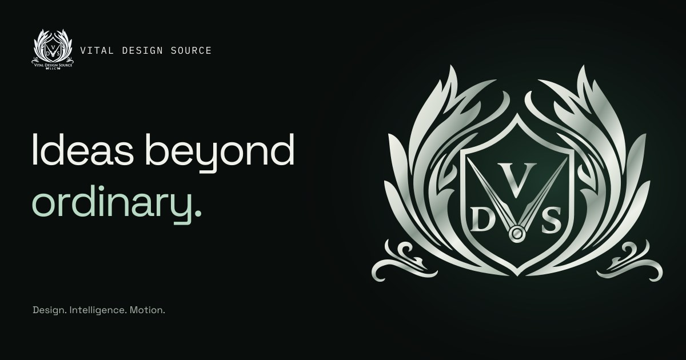

# Vital Design Source

The official Vital Design Source LLC website: an independent React and TypeScript build with the preserved original heraldic crest, an animated SVG crest refinement, an on-demand cinematic brand film, the Aurora Celadon design system, eight portfolio projects with dedicated studies, an interactive workflow demonstration, and a private project inquiry service.



The studio offers web design, development, branding, SEO, intelligent automation, and human-directed AI design and motion. The AI Design Lab presents three distinct local compositions: liquid chrome, translucent prismatic facets, and an ivory editorial specimen. Visitors can pause motion and carry a chosen direction into their inquiry. It is an interactive art-direction study, not a live AI generation service.

The separate **Intelligence in practice** demonstration explores three example
requests through Capture, Organize, Review, and Handoff. Its sample messages and
outputs are checked-in illustrations; selecting stages sends no AI request and
connects no external tools. Visitors can carry a selected workflow example into
the existing inquiry form without losing their draft.

## Deploy on Hostinger

Import this repository as a **Node.js Web App** with these settings:

| Setting         | Value     |
| --------------- | --------- |
| Framework       | Express   |
| Branch          | main      |
| Node version    | 24.x      |
| Root directory  | ./        |
| Package manager | npm       |
| Entry file      | server.js |

Connect **vitaldesignsource.com** and deploy. The website and private inquiry storage work without environment variables. The app builds automatically when needed, uses the official domain, generates its private security key, and saves inquiries outside the deployment directory.

All inquiry paths share the same form and email queue. The default notification destination is **Vitaldesignsource@gmail.com**. Actual email delivery requires a verified sending account configured through the host's protected SMTP settings; an address alone cannot send mail. Saved inquiries remain queued and retry after sending is configured. See [email setup](docs/deployment.md#email-notifications).

If you entered settings during an earlier setup attempt, remove obsolete preview `SITE_URL` and relative `DATABASE_PATH` overrides. Keep any valid email settings. Hostinger supplies the port automatically.

See [deployment instructions](docs/deployment.md) for domain switching, inquiry access, optional email notifications, backups, and other hosts. The inquiry API requires a Node host; a PHP/HTML file deployment or GitHub Pages cannot run it.

## Run locally

Requires **Node.js 24 LTS** and npm:

```sh
npm ci
NODE_ENV=development npm start
```

Open <http://localhost:3000>. The first start builds the application. Development mode saves test inquiries to `data/inquiries.sqlite` and disables search indexing. This directory is excluded from Git and must stay private.

For development, first build once, then run these in separate terminals:

```sh
SITE_URL=http://localhost:5173 npm run dev:server
npm run dev
```

Vite proxies `/api` to the local Node server. Match the browser origin exactly; `localhost` and `127.0.0.1` are different origins.

## Validate

```sh
npx playwright install chromium
npm run validate
```

This runs strict TypeScript checks, ESLint (including accessibility rules), API/storage tests, production builds, and desktop/mobile browser tests with axe accessibility checks. To use an existing Chromium installation, set `CHROMIUM_PATH=/path/to/chromium`. CI runs the same checks.

CI also runs `npm run test:deployment`: a disposable production-only install that checks automatic builds, default official-domain metadata, private inquiry storage, and restart persistence without manual environment setup.

## Maintain

- `src/components/`: accessible page sections and interactions.
- `src/components/DesignLab.tsx`: curated visual-direction explorer with selection controls, live brief updates, and a motion toggle. Offscreen and background-tab suspension preserves the visitor’s motion preference.
- `src/components/DesignLabArtwork.tsx`: responsive local image, SVG glass study, and typographic artwork for the three directions. Decorative motion uses the Lab’s existing visibility and preference controls.
- `src/components/StudioProcess.tsx` and `src/lib/studio-process.ts`: four selectable process phases with practical focus points, collaboration notes, and original vector diagrams. Selection triggers one short line trace; reduced-motion visits remain static.
- `src/lib/creative-starting-point.ts` and `src/components/InquiryForm.tsx`: removable direction/service context for inquiries. Visitor drafts and manually chosen project types stay intact; context is disclosed and appended to the message within the existing validation and length limits.
- `src/components/AuroraBackdrop.tsx`, `SignalBanner.tsx`, and `SectionContours.tsx`: local inline SVG atmosphere in obsidian, platinum, jade, and celadon light. The hero’s existing motion control also governs its aurora; the decorative interlude runs one optional 4.2-second pass, and section contours stay static. Visibility, reduced-motion, and data-saving preferences govern motion.
- `src/components/BackgroundAtmosphere.tsx` and `src/styles/background-atmosphere.css`: a separate viewport-sized ambient layer behind the homepage’s transparent dark sections. Two soft gradient fields and faint SVG contours drift slowly using CSS transforms. Synchronized controls in the hero and footer pause the background without changing hero or Lab motion; hidden tabs suspend the animation clock, and reduced-motion/data-saving/no-JavaScript visits retain the static artwork. No canvas, filters, media downloads, or animation-frame loop are added.
- `src/components/ScrollChoreography.tsx`: once-only 800ms position entrances for initially offscreen headings and supporting text. Text stays fully opaque throughout; interactive containers remain stationary so pointer targets stay stable. Keyboard focus reveals content immediately; content remains visible without JavaScript, with reduced motion, or with data saving enabled.
- `src/components/BrandFilm.tsx` and `src/lib/brand-film.ts`: poster-first, eight-second silent Higgsfield identity film, shown below the hero and discipline bar. Playback requires an explicit play request; the video source is absent initially, with `preload="none"` and no autoplay. Hidden or offscreen playback pauses, manual pause remains respected, and replay or retry requires visitor action. Shared metadata supplies the pre-rendered `VideoObject` structured data.
- `src/components/CrestSculpture.tsx` and `src/lib/crest-scene.ts`: optional Three.js crest loaded and initialized only when visible, with vector extrusion, planar caps, smoothed bevels, local reflections, and one 4.2-second diagonal silver light pass. The existing hero motion control pauses and resumes its remaining time; visibility also suspends it. After it settles, pointer-responsive lighting can sleep. Rendering targets 30fps and adapts pixel density up to 2.5 within a 2.4-megapixel buffer budget. The hero-only SVG fallback is static; reduced-motion and data-saving visits stay quiet.
- `src/lib/crest-finish.ts`: shared hero-only finish roles for subtle feather and flourish translucency while the core identity stays opaque. The geometry, navigation crest, original brand files, and film remain unchanged.
- `src/components/ProjectShowcase.tsx` and `src/lib/project-studies.ts`: accessible showcases for eight projects, with factual visual studies, full/detail views where a preview is available, the refreshed 7 Seas Trading website capture, and external-site links.
- `src/components/ProjectPage.tsx` and `src/styles/project-page.css`: dedicated editorial studies at `/work/<project-id>`, using the existing previews, disclosed detail crops, visual observations, sampled palettes, and previous/next navigation. They describe documented visual material and do not invent project briefs, roles, or outcomes.
- `src/lib/project-routes.ts`: the shared allowlist for project links, pre-rendering, sitemap entries, server routes, and client resolution. Project-specific structured data is permitted through hashes from only the known built pages.
- `src/components/AIWorkflow.tsx` and `src/lib/workflow-examples.ts`: local illustrative workflow scenarios, accessible stage controls, and human-review checkpoints. Their optional inquiry handoff uses the existing strict message validation and API shape.
- `src/lib/project-palettes.ts`: four labeled preview-derived color samples per project, with source checksums. See [color-study provenance](docs/palette-sources.md) for deterministic regeneration and interpretation.
- `src/components/BrandCrest.tsx`: inline SVG navigation crest with unique IDs, a visible filled base, a brief reveal and highlight, hover interaction, and static reduced-motion styling.
- `src/lib/content.ts`: project destinations, descriptions, service copy, and form options.
- `src/lib/crest-geometry.json`: checked-in vector paths for the refined crest.
- `src/lib/design-directions.ts`: typed art-direction presets, briefs, and material labels for the AI Design Lab.
- `src/lib/inquiry.ts`: shared client/server validation contract.
- `server/`: HTTP boundary, SQLite persistence, and optional email queue.
- `server.js`: portable host entry; builds missing or outdated-domain artifacts before starting.
- `site.config.json`: official domain used by the build and server.
- `scripts/build.ts`: pre-rendered home, privacy and 404 pages; metadata, JSON-LD, sitemap, robots; bundled Node server.
- `scripts/brand-assets.ts`: generates standalone SVG crest variants and an outlined wordmark from checked-in paths.
- `public/assets/`: self-hosted, deployable brand and responsive image assets.
- `source-assets/`: retained artwork and portfolio preview masters.
- `tests/`: behavior, persistence, abuse boundary, and accessibility checks.

Use `npm run assets` after changing image masters; it also regenerates the SVG brand exports. To regenerate only the brand exports, run `npm run assets:brand`. Normal builds and SVG export generation require no Python tooling.

The film is an AI-assisted interpretation of Vital Design Source’s own identity, generated from the original supplied crest. Its retained source and provenance record are in `source-assets/brand/`. Optional `npm run assets:film` uses FFmpeg to prepare the local H.264 film and WebP poster; normal builds deploy the checked-in assets and require no FFmpeg or new generation.

The original standalone brand set includes ink, silver, and briefly animated crests plus an outlined wordmark. View it at `/assets/brand/preview.html` on the running site. The separate `vital-crest-aurora.svg` supplies the static hero fallback and is also regenerated by `npm run assets:brand`. All 12 pre-existing brand assets remain byte-for-byte unchanged by this hero treatment. Original brand files continue to appear in the Studio section, footer, social image, and favicons. See [asset provenance](docs/assets.md) for the refinement workflow and optional tracing tools. The website includes no testimonials, client performance metrics, or invented project outcomes.

Aurora Celadon pairs deep green-black surfaces with pale platinum, jade, and restrained teal-blue light. Its new contour artwork uses original inline SVG and CSS, using the existing dependencies and deployment setup; the original crest and previously approved film remain unchanged.

## Review inquiries

Run only from an authorized server terminal:

```sh
npm run inquiries
npm run inquiries -- --delete <inquiry-uuid>
```

The first command displays the newest 50 submissions. Treat its output as private. Production storage defaults to `~/.local/share/vital-design-source/inquiries.sqlite`; the CLI uses the same path as the server. To view local development records, prefix the command with `NODE_ENV=development`.

There is no public administration endpoint. SMTP notifications to **Vitaldesignsource@gmail.com** retry from the saved queue once the sending account is configured; without SMTP, review inquiries through this command. Verify that your host preserves the private storage directory across redeployments.

All original brand artwork and site assets remain proprietary to their respective owners. Third-party code and fonts retain their licenses; see [notices](docs/third-party-notices.md).
